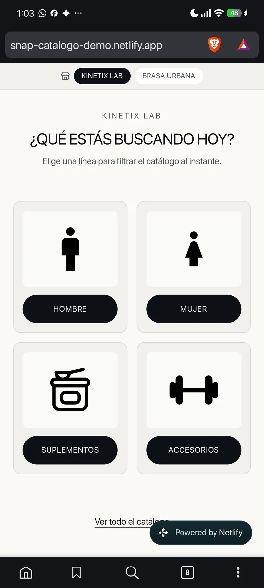
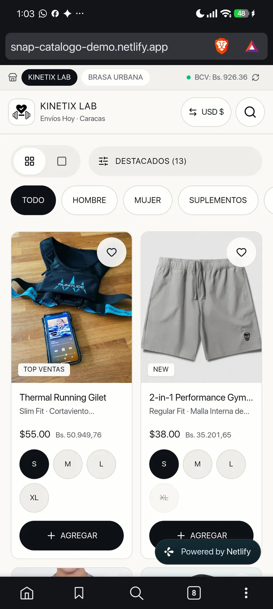
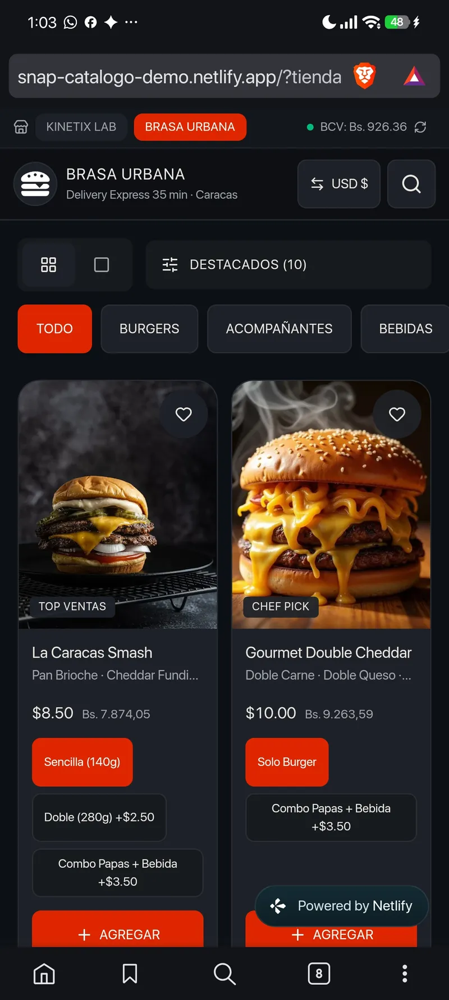
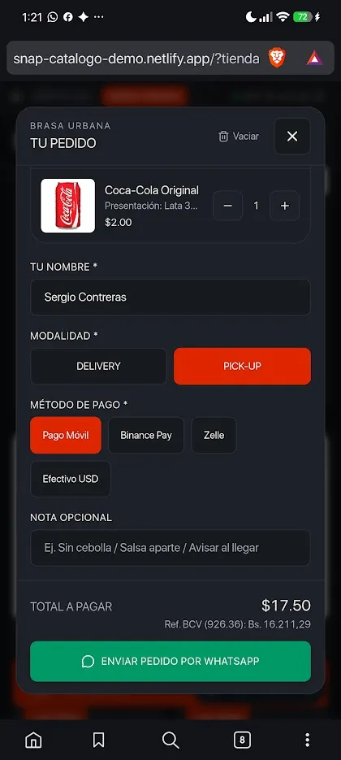
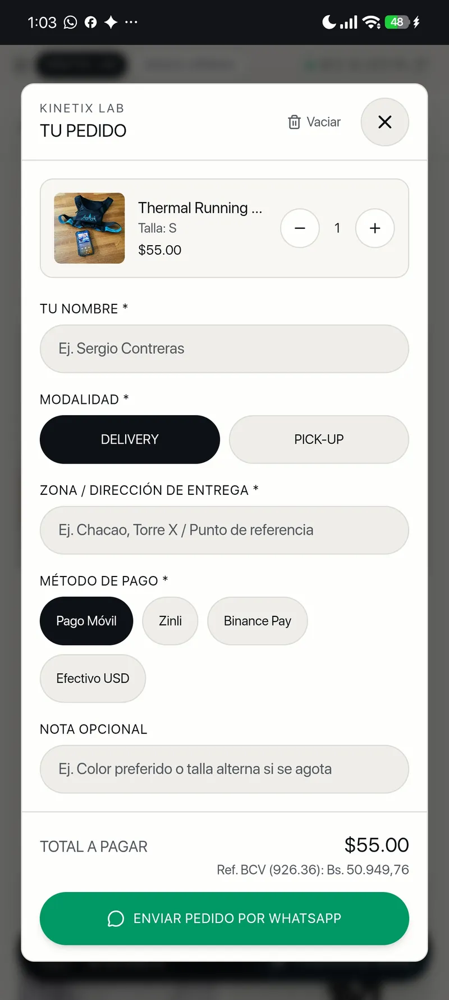

<div align="center">

# Snap Catálogo
### Motor de Catálogo Interactivo Multi-Tienda (*White-Label*)

Aplicación web *mobile-first* diseñada para comercios que venden por WhatsApp y necesitan convertir visitas en pedidos estructurados en **3 toques**, con identidad visual adaptable por marca, conversión automática a **tasa BCV diaria** y conexión desacoplada a múltiples fuentes de inventario.

<p>
  <a href="https://snap-catalogo-demo.netlify.app/?tienda=kinetix">
    
  </a>
  
  
  
  
  
</p>

[Ver Demo Kinetix Lab](https://snap-catalogo-demo.netlify.app/?tienda=kinetix) · [Ver Demo Brasa Urbana](https://snap-catalogo-demo.netlify.app/?tienda=brasa-urbana)

</div>

---

## Demos en Vivo (Instancias Multi-Tienda)

Un único despliegue sirve múltiples rubros comerciales leyendo el parámetro `?tienda=<slug>` desde la URL:

| Rubro Comercial | Marca Demo | Enlace Directo | Esquema Visual |
| :--- | :--- | :--- | :--- |
| **Ropa Deportiva & Suplementos** | `Kinetix Lab` | [`/?tienda=kinetix`](https://snap-catalogo-demo.netlify.app/?tienda=kinetix) | Claro · Acento Técnico · `EntryGate` activo |
| **Delivery & Comida Rápida** | `Brasa Urbana` | [`/?tienda=brasa-urbana`](https://snap-catalogo-demo.netlify.app/?tienda=brasa-urbana) | Oscuro Nocturno · Acento Brasa · Acceso directo |

---

## Revisión Visual de Capturas en Producción

Las cuatro capturas tomadas desde el navegador móvil en `https://snap-catalogo-demo.netlify.app/` confirman una ejecución visual sólida y coherente en ambos esquemas de color:

Las cinco capturas tomadas desde el navegador móvil en `https://snap-catalogo-demo.netlify.app/` muestran el flujo completo de navegación, selección de modalidad y cierre de pedido en ambos esquemas visuales:

| Vista del Flujo | Captura | Descripción |
| :--- | :--- | :--- |
| **Selector de líneas (`Kinetix Lab`)** |  | Los cuatro bloques de categoría (*Hombre*, *Mujer*, *Suplementos*, *Accesorios*) mantienen proporciones uniformes, buen aire visual y contraste limpio sobre el fondo claro. |
| **Catálogo en cuadrícula (`Kinetix Lab`)** |  | Se aprecia la barra superior con la tasa BCV activa (`BCV: Bs. 926.36`), el selector `USD $`, los filtros por categoría y las tarjetas de producto con precios duales en dólares y bolívares. |
| **Catálogo en modo oscuro (`Brasa Urbana`)** |  | El cambio a tema oscuro respeta el contraste de textos, etiquetas (*Top Ventas*, *Chef Pick*), recargos por variante (`+$2.50`, `+$3.50`) y botones de acción. |
| **Modalidad Pick-up (`Brasa Urbana`)** |  | Configura la recogida directa en tienda (*Pick-up*) dentro del flujo de pedido con cálculo claro en moneda dual y sin depender de zona de delivery. |
| **Checkout por WhatsApp** |  | La vista *Tu Pedido* organiza el ítem o pedido seleccionado, cantidad, modalidad, métodos de pago, nota opcional y el total dual (`$55.00` y `Bs. 50.949,76`) encima del botón verde de WhatsApp. |

> **Seguridad al probar y capturar en móvil:** Evita usar números aleatorios o secuencias que coincidan con líneas reales en entornos de prueba, y prefiere números ficticios no asignados como `+58 412-0000000` (`584120000000`) o una confirmación explícita antes de disparar enlaces `wa.me` durante pruebas en el teléfono.

---

## Características Técnicas Destacadas

### Arquitectura Camaleón Multi-Tienda (`OKLCH` + `Display-P3`)
* Cada comercio inyecta sus propios tokens semánticos (`accent`, `onAccent`, `highlight`, radios de borde y esquema claro/oscuro) en tiempo de ejecución **sin recompilar CSS**.
* Contraste perceptual calculado mediante **APCA** para garantizar legibilidad automática en botones y etiquetas sin importar el color de marca.

### Consenso Multi-Proveedor de Tasa BCV (*Resiliencia Offline*)
* Consulta concurrente (`Promise.allSettled`) a múltiples APIs públicas del Banco Central de Venezuela con selección protectora de tasa vigente.
* Caché local de **30 minutos**, botón de recarga manual en cabecera y tasa de respaldo configurable por comercio en caso de caída de red.
* **Precisión Financiera:** Todos los cálculos monetarios (`USD <-> Bs.`) se ejecutan en centavos enteros escalados para evitar imprecisiones binarias de punto flotante (`IEEE 754`).

### Patrón Repositorio / Adaptador para Inventario
Interfaz única `IStoreRepository` que permite cambiar el origen de datos por tienda sin modificar ni un solo componente Vue:
1. **`local` (Semillas Estáticas):** Carga perezosa (*lazy loading*) para demos instantáneas o catálogos fijos.
2. **`sheets` (Google Sheets — Costo `$0`):** Hoja publicada como CSV; el comerciante edita precios y stock en tiempo real desde su teléfono.
3. **`api` (API REST):** Integración directa con backends propios (FastAPI, Supabase, etc.).

### UX Nativa sin Bloat (`45.9 kB` JS + `7.4 kB` CSS gzip)
* **View Transitions API:** Conmutador fluido entre vista de cuadrícula (`2 columnas`) y vista de detalle (`1 columna`).
* **Accesibilidad Nativa:** Ficha de producto y flujo de checkout construidos sobre `<dialog>` nativo (*top layer*, cierre con `Escape` y regiones `aria-live="polite"`).
* **Micro-interacciones Táctiles:** Stepper reversible en tarjeta (`🗑 / - | N | +`) con áreas táctiles mínimas de `44x44px` (`touch-action: manipulation`) y curva física *spring* CSS (`linear()`).

---

## Stack Tecnológico

| Capa | Tecnología | Propósito |
| :--- | :--- | :--- |
| **Core & Tipado** | Vue 3 (`<script setup>`) · TypeScript 5 | Reactividad granular con tipado estricto (`strict` + `erasableSyntaxOnly`) |
| **Estilos & Color** | Tailwind CSS v4 (`@tailwindcss/vite`) | Tokens dinámicos `OKLCH` y puente nativo `@theme` |
| **Build & Calidad** | Vite · Vitest + jsdom · Biome | Empaquetado ultrarrápido, pruebas unitarias y linting estricto |
| **Optimización Media** | `sharp` · SVG normalizados | Conversión por lote a WebP (`800px`, `< 145 KB` por imagen) |

---

## Arquitectura del Proyecto

```text
src/
├── config/
│   └── stores.registry.ts          # Registro multi-tienda (identidad OKLCH, reglas y origen BD)
├── types/
│   └── store.types.ts              # Contratos estrictos de dominio e inventario
├── services/
│   ├── bcv.service.ts              # Consenso BCV concurrente + caché + fallback
│   └── database/
│       └── repository.factory.ts   # Patrón Adaptador (Local / Google Sheets / REST API)
├── composables/
│   ├── useStore.ts                 # Inyección de tema, moneda USD/Bs. y tasa BCV
│   └── useCart.ts                  # Carrito aislado por tienda y variante en localStorage
├── utils/
│   ├── currency.ts                 # Aritmética escalada USD <-> Bs. y formateadores Intl
│   ├── search.ts                   # Búsqueda normalizada NFD (insensible a tildes) y ordenamiento
│   └── whatsapp.ts                 # Generador de tickets estructurados para wa.me
├── styles/
│   └── tokens.css                  # Tokens semánticos OKLCH + puente @theme de Tailwind v4
└── components/                     # BrandSplash, EntryGate, HeaderBar, FilterToolbar,
                                    # ProductCard, ProductDetailDialog, StickyCartBar, CheckoutDialog
```

---

## Instalación y Comandos

Clona el repositorio e instala las dependencias locales:

```bash
# 1. Instalar dependencias
npm install

# 2. Levantar servidor de desarrollo local
npm run dev

# 3. Verificación estricta de tipos (Vue + TypeScript)
npx vue-tsc --noEmit

# 4. Ejecutar suite de pruebas unitarias (6 suites / 11 tests)
npm test

# 5. Compilar para producción y previsualizar el bundle final
npm run build
npm run preview
```

---

## Cómo Conectar un Catálogo por Google Sheets *(Costo `$0`)*

Permite que cualquier comercio administre su inventario sin panel administrativo ni servidores adicionales:

1. **Crea una hoja de cálculo** en Google Sheets y coloca exactamente estos encabezados en la **Fila 1**:
   ```csv
   id,sku,name,subtitle,category,badge,priceUsd,images,description,variantLabel,variants
   ```
2. **Formatea los campos compuestos:**
   * **Múltiples imágenes:** Separa las URLs con una barra vertical (`|`). Ejemplo: `url1.webp|url2.webp`
   * **Variantes y Stock:** Usa el formato `Variante:Cantidad|Variante:Cantidad`. Ejemplo: `S:5|M:10|L:0` *(si el stock es `0`, la variante se marca como agotada automáticamente)*.
3. **Publica la hoja en la web:**
   * Ve a **Archivo → Compartir → Publicar en la web**.
   * Selecciona la pestaña correspondiente y elige el formato **Valores separados por comas (`.csv`)**.
   * Copia el enlace generado.
4. **Registra la tienda:**
   Abre `src/config/stores.registry.ts` y agrega la configuración de tu comercio apuntando al CSV:
   ```typescript
   dataSource: {
     type: 'sheets',
     csvUrl: 'TU_URL_CSV_PUBLICADA',
   }
   ```

---

## Despliegue SPA en Netlify

El proyecto incluye `netlify.toml` para redirigir rutas SPA hacia `index.html`, aplicar caché inmutable en `/stores/*` y reforzar cabeceras de seguridad:

| Ajuste en Netlify | Valor |
| :--- | :--- |
| **Build command** | `npm run build` |
| **Publish directory** | `dist` |
| **Node version** | `20.x` o superior |